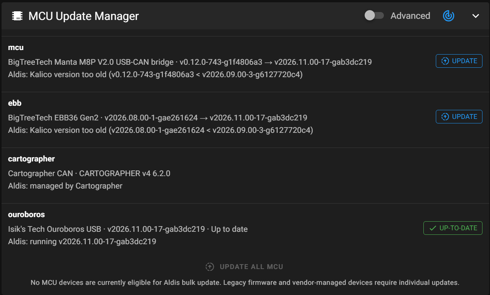

# MCU Update Manager

Experimental Mainsail panel and Moonraker component for discovering and updating Klipper/Kalico MCUs connected over CAN or USB. The panel can match a device to a hardware profile, build firmware, flash supported devices, show operation progress and logs, and select older firmware versions. Cartographer and STM32 DFU have guided flows. **A profile appearing in the catalog does not mean that automatic flashing is supported for that board.**



Example panel with mixed firmware versions; device status and versions vary by printer.

## Before you install

- This is a **beta**. Flashing the wrong profile, pins, bootloader offset, or target can make a board inaccessible until you recover it in DFU/BOOTSEL. Check the exact board revision and have a recovery method ready.
- The prebuilt UI is based on **Mainsail v2.19.0**. It replaces the files in `~/mainsail`; it is not a runtime Mainsail plugin. A later Mainsail update can remove the panel. Do not use the UI package on a different Mainsail version without rebuilding it.
- The installer backs up Mainsail and Moonraker configuration. It does **not** flash firmware, change `printer.cfg`, or restart Klipper. Run it when the printer is idle.
- Standard paths are assumed: `~/mainsail`, `~/moonraker`, and `~/printer_data/config/moonraker.conf`. Review `scripts/install.sh` if your setup differs.
- Python 3.11 or newer, `git`, `curl`, and `tar` are needed on the printer host. CAN/USB/DFU flashing additionally needs the relevant tools (such as Katapult and `dfu-util`).
- Supported current MCU updates use the Aldis Moonraker agent; install and configure it separately. Older firmware without embedded build configuration can use a reviewed, user-confirmed profile. Cartographer firmware is managed separately.
- Aldis 0.4.0 can fail to detect Katapult when a USB-CAN bridge re-enumerates, leaving Klipper stopped and the bridge in Katapult. A [proposed upstream fix](https://github.com/mjonuschat/aldis/pull/4) was tested on one Manta M8P V2.0; check its status and have a recovery method before updating a bridge.

## Install on a printer

### 1. Install Aldis

The current update workflow needs the [Aldis Moonraker agent](https://github.com/mjonuschat/aldis). If Aldis is already installed, do not overwrite it: check `~/aldis/aldis --version` and `~/aldis/aldis setup --check`, and follow its documentation for upgrades.

For a new installation, SSH into the printer and run the following when it is idle. These commands install the official v0.4.0 binary and configure its systemd service and permissions; review the [Aldis setup instructions](https://github.com/mjonuschat/aldis#setup) first:

```bash
(
set -eu
test ! -e "$HOME/aldis/aldis" || { echo "Aldis is already installed; do not overwrite it."; exit 1; }
mkdir -p ~/aldis
curl -fL "https://github.com/mjonuschat/aldis/releases/download/v0.4.0/aldis-$(uname -m)-linux.tar.xz" -o /tmp/aldis-v0.4.0.tar.xz
tar xJf /tmp/aldis-v0.4.0.tar.xz -C ~/aldis --strip-components=1
chmod +x ~/aldis/aldis
~/aldis/aldis --version
sudo ~/aldis/aldis setup
sudo ~/aldis/aldis setup --agent
sudo systemctl restart moonraker
~/aldis/aldis setup --check
systemctl is-active aldis
)
```

**USB-CAN bridge warning:** the official Aldis 0.4.0 binary may leave a bridge in Katapult and Klipper stopped during an update. The proposed fix linked above is not included in the official binary. Do not update a USB-CAN bridge with this version until you have checked the fix status and prepared recovery.

### 2. Install MCU Update Manager

On the printer, run:

```bash
cd ~
git clone https://github.com/locki-cz/mcu-update-manager.git
cd mcu-update-manager
bash scripts/install.sh
```

The installer downloads the matching [beta release](https://github.com/locki-cz/mcu-update-manager/releases), backs up `~/mainsail`, installs the Moonraker component, adds an include to `moonraker.conf` if needed, restarts Moonraker, and verifies its API. Refresh Mainsail with Ctrl+F5 and open **Machine > MCU Update Manager**. Configured MCUs are loaded automatically; scan for additional USB, DFU and CAN devices with the button in the panel header.

If Katapult is not installed, the panel can still discover devices, but Katapult-based flashing will not be available. Do not confirm a profile until you have verified the exact board and revision.

For an existing `main` checkout, run `git pull --ff-only` and then `bash scripts/install.sh` to update both the backend and the matching Mainsail panel. The installer makes a fresh backup before replacing the UI. This beta does not automatically merge with newer Mainsail versions.

## Verify or troubleshoot

```bash
curl -fsS http://127.0.0.1:7125/machine/mcu_update_manager/status
systemctl is-active moonraker
journalctl -u moonraker -n 80 --no-pager
```

The API response should contain `devices` (possibly empty before discovery). A 404 means the Moonraker component did not load. Check its error in the journal. The Moonraker entry should link to `~/mcu-update-manager/moonraker_component_entry.py`, **not** directly to `mcu_update_manager/moonraker_component.py`; the installer handles this. If the status endpoint works but a newer frontend reports empty hardware menus, check `/machine/mcu_update_manager/profile/options`. A 404 there means Moonraker is still loading an older component; update the checkout and restart Moonraker.

The installer prints the backup directory it created. To restore the previous Mainsail UI, extract its `mainsail-*.tar.gz` backup into your home directory. Restore the corresponding `moonraker.conf` and component backup only if you also want to remove the backend integration, then restart Moonraker.

## Hardware profiles and source

Profiles are YAML files under [`profiles/`](profiles/README.md), grouped into `mainboard`, `toolhead`, `cartographer`, and `beacon`. The user's confirmed device-to-profile assignments are stored separately in `devices.yaml` on the printer and are not part of this repository. Many catalog entries are discovery-only placeholders; only profiles with complete build and flash settings can be used automatically.

### Custom hardware profiles

Use **Custom hardware profile** in the Machine panel to create a profile from scratch, or expand a device and choose **Copy profile**. A saved custom profile has its own ID and can be edited later. Catalog profiles are read-only. The form checks names against both catalogs without regard to case, and checks the chip, transport, update method, and matching Klipper/Katapult offsets. Saving a profile does not confirm a device, compile, or flash anything.

User profiles are stored under `~/printer_data/config/mcu_update_manager/profiles/`, outside this Git checkout, and survive `git pull`. Set `custom_profile_dir` in `mcu_update_manager.cfg` to use another location. These `.yaml` files contain JSON-formatted YAML so the built-in parser can read them even when PyYAML is unavailable. The branch currently supports only the processor and pin combinations understood by its automatic configuration generator; unsupported hardware still needs a reviewed catalog profile or manual firmware setup.

The `v0.1.0-beta.4` release includes the custom-profile editor for Mainsail v2.19.0. The template list contains Klipper build profiles, not vendor firmware profiles such as Cartographer. Do not deploy or update during a print.

The Moonraker component lives in [`mcu_update_manager/`](mcu_update_manager/) and registers `/machine/mcu_update_manager/*` endpoints. The UI is currently compiled into a Mainsail 2.19.0 build. [`frontend/`](frontend/README.md) contains the panel source and integration patch so the modified frontend can be inspected and rebuilt. This is **not** an official Mainsail plugin and is not affiliated with the Mainsail team.

## Thanks and sources

This project stands on the work, documentation and ideas of many people. A big thank you to all contributors and maintainers; without their work this project would not be possible. Links below distinguish the projects and references we have used from the code maintained here. None of these projects is affiliated with or endorses MCU Update Manager.

- [Mainsail](https://github.com/mainsail-crew/mainsail), [Moonraker](https://github.com/Arksine/moonraker), [Klipper](https://github.com/Klipper3d/klipper) and [Kalico](https://github.com/KalicoCrew/kalico), for the host, API and firmware foundations.
- [Aldis](https://github.com/mjonuschat/aldis) and [Katapult](https://github.com/Arksine/katapult), for MCU update and bootloader tooling.
- [Esoterical's CAN bus guide](https://canbus.esoterical.online/) and [USB flashing guide](https://usb.esoterical.online/), for hardware configuration and flashing documentation.
- [Cartographer firmware](https://github.com/Cartographer3D/cartographer_firmware) and [Cartographer documentation](https://docs.cartographer3d.com/), for vendor firmware and probe guidance.
- [Mellow documentation](https://mellow-3d.github.io/), [FYSETC documentation](https://wiki.fysetc.com/) and [FYSETC ERB](https://github.com/FYSETC/FYSETC-ERB), [BIGTREETECH documentation](https://global.bttwiki.com/), and [Isik's Tech Ouroboros guide](https://docs.isiks.tech/Ouroboros/Firmware-Setup/), for hardware information.
- [Klipper-EZFlash](https://github.com/Klipper-EZFlash/klipper-ezflash), [update_klipper_and_mcus](https://github.com/fbeauKmi/update_klipper_and_mcus), and [AFC-Klipper-Add-On](https://github.com/ArmoredTurtle/AFC-Klipper-Add-On), for workflow and integration inspiration.

This project and the modified Mainsail frontend are distributed under GPL-3.0; see the upstream projects for their respective licenses and credits.
